# Tivi Home

Màn hình chính (launcher) cho **Android TV / TV box**, giao diện kính mờ trên nền gradient: đồng hồ lớn, lịch tháng có
**âm lịch**, **thời tiết**, dock ứng dụng sắp xếp được, **khoá trẻ em** hẹn giờ và **bàn phím tiếng Việt (Telex)**
cùng phong cách. Điều khiển hoàn toàn bằng remote,
giao diện tiếng Việt. Kèm theo là **design system** đầy đủ để bạn — hoặc bất kỳ AI nào — thiết kế thêm màn hình cùng
phong cách.

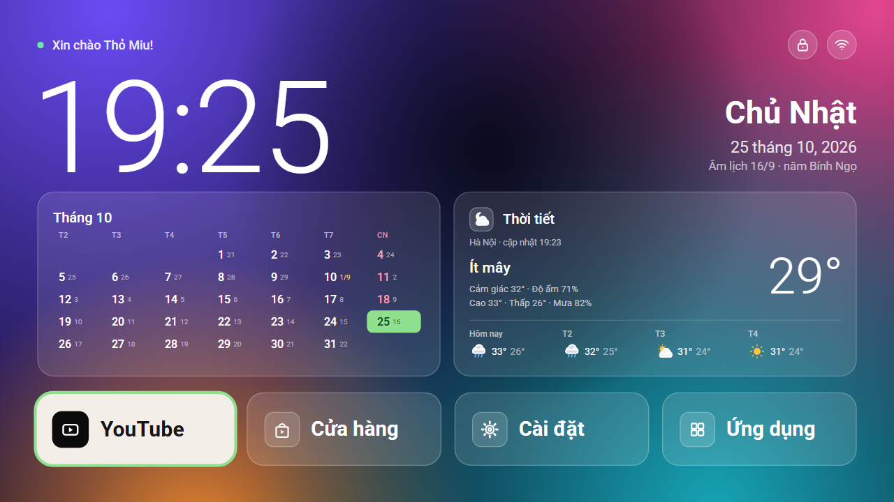

| | |
|---|---|
| 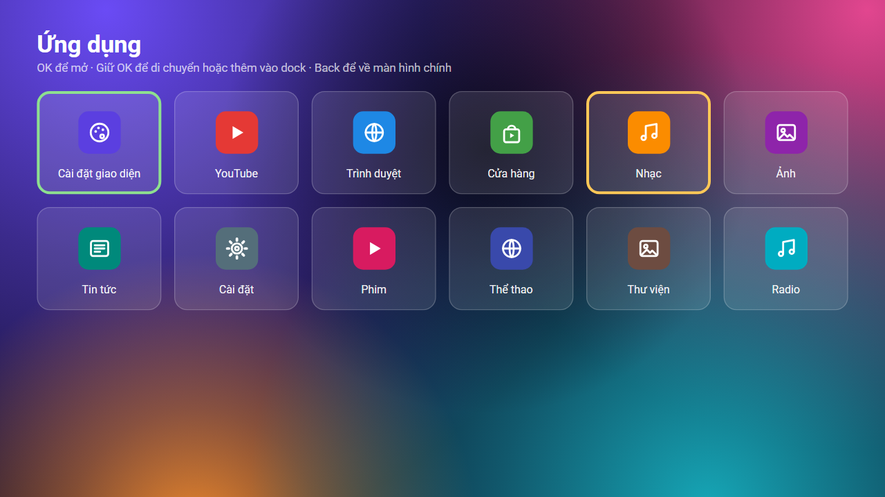 | 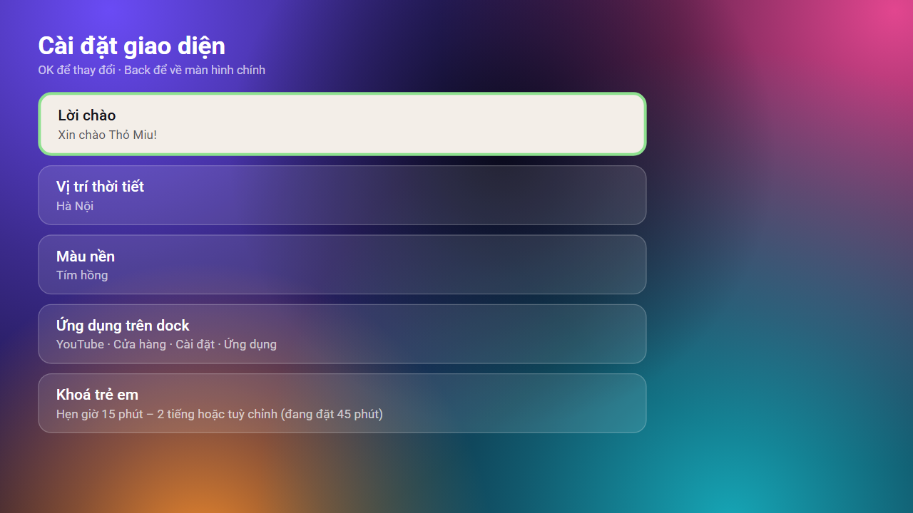 |
| 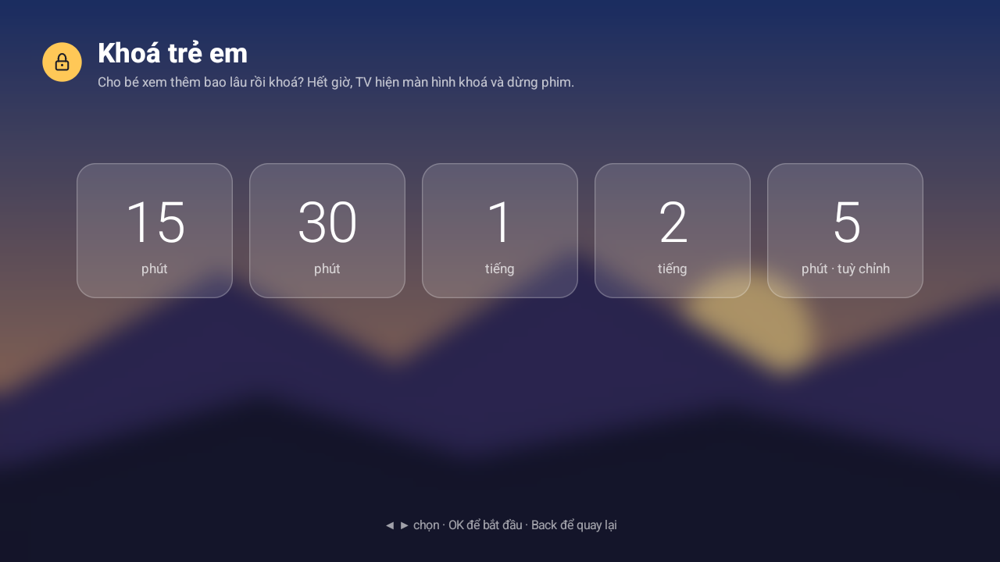 | 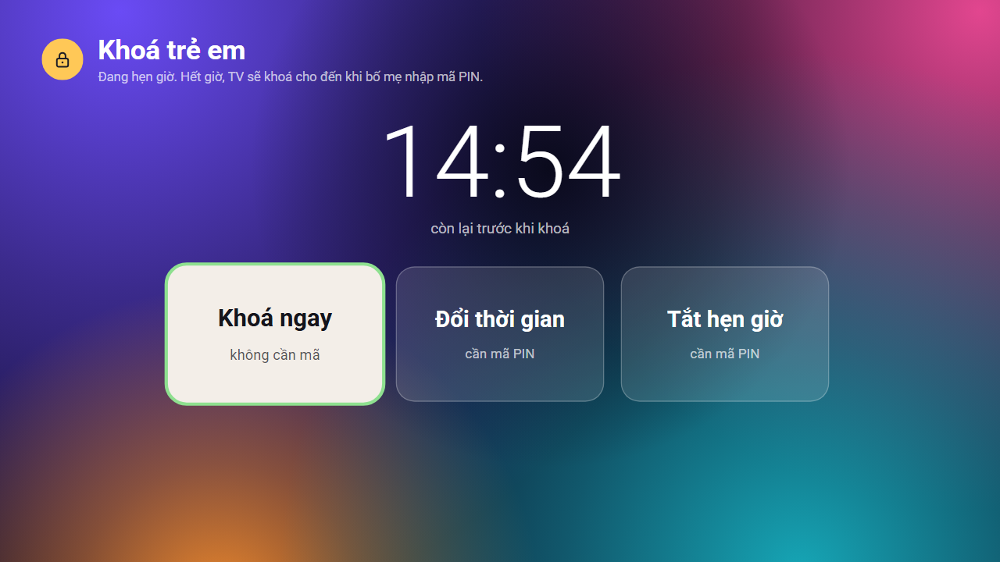 |
| 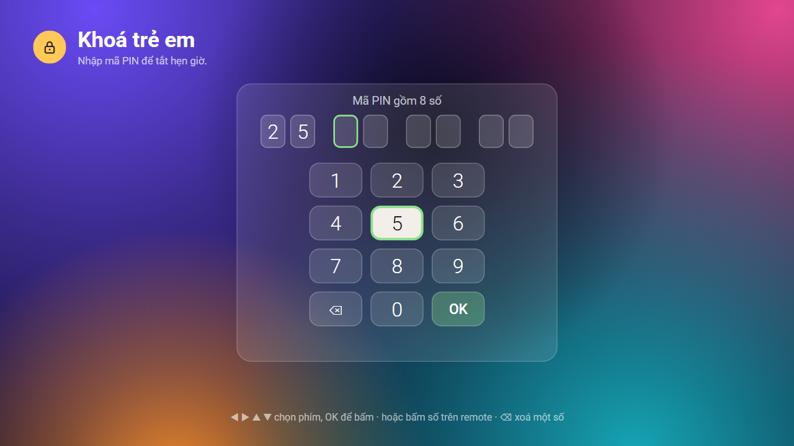 | 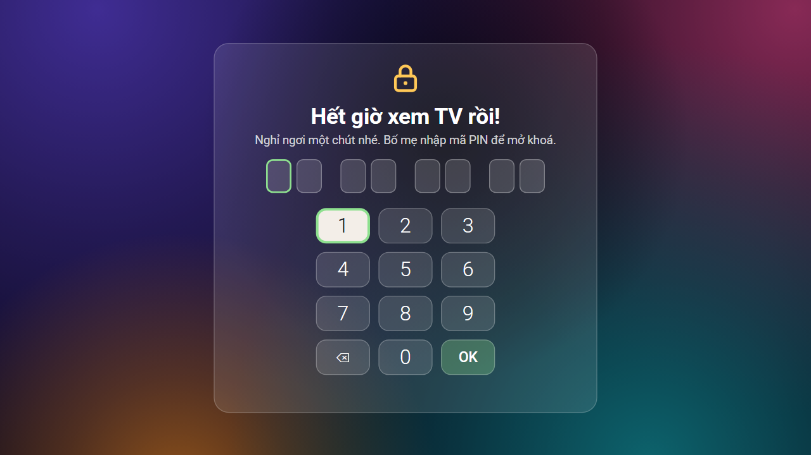 |

| | |
|---|---|
| 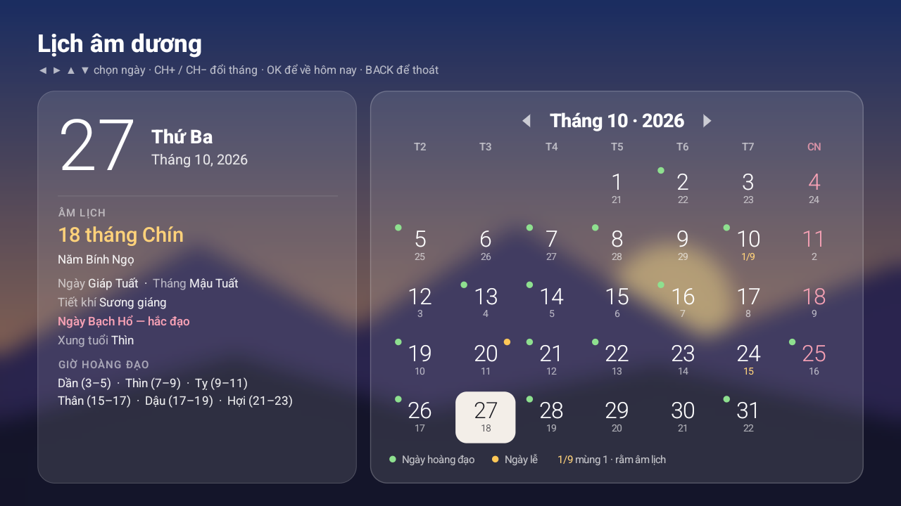 | 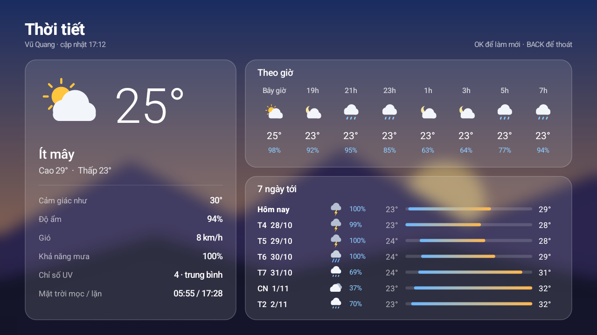 |
| 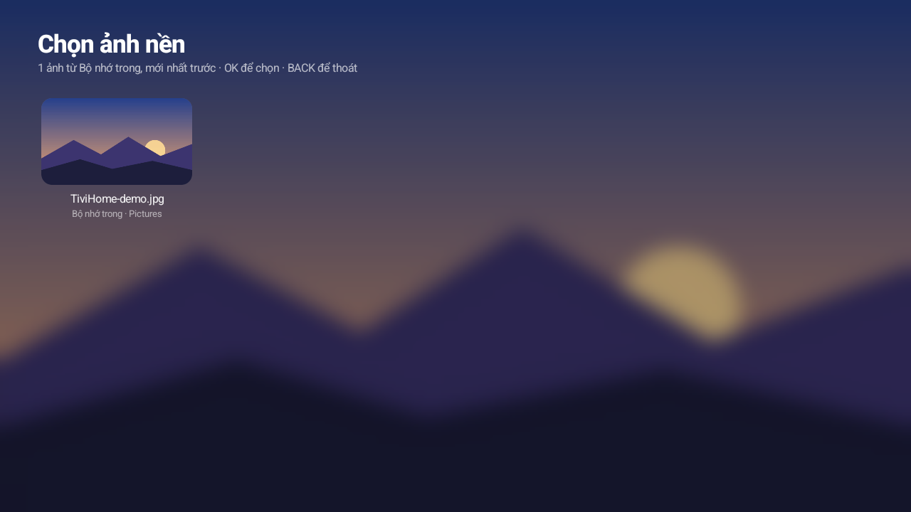 | 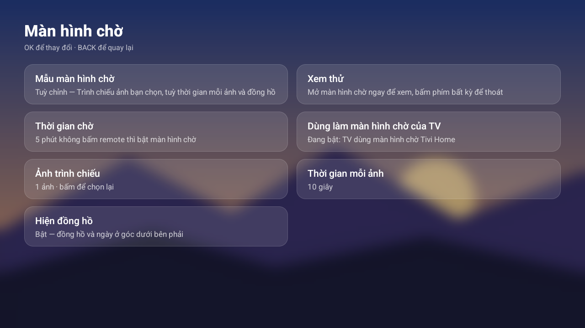 |

**6 mẫu màn hình chờ**

| | | |
|---|---|---|
| 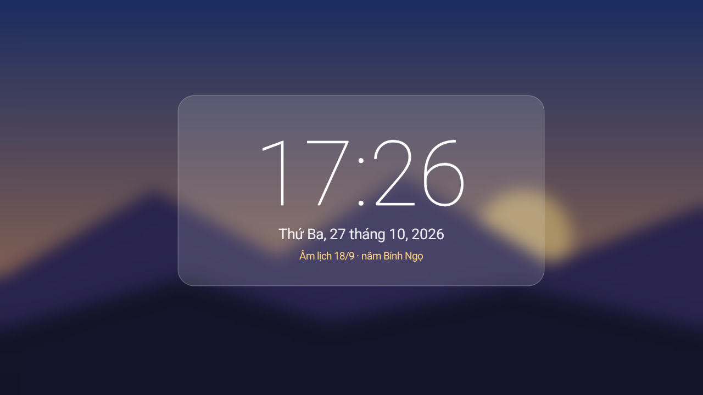 | 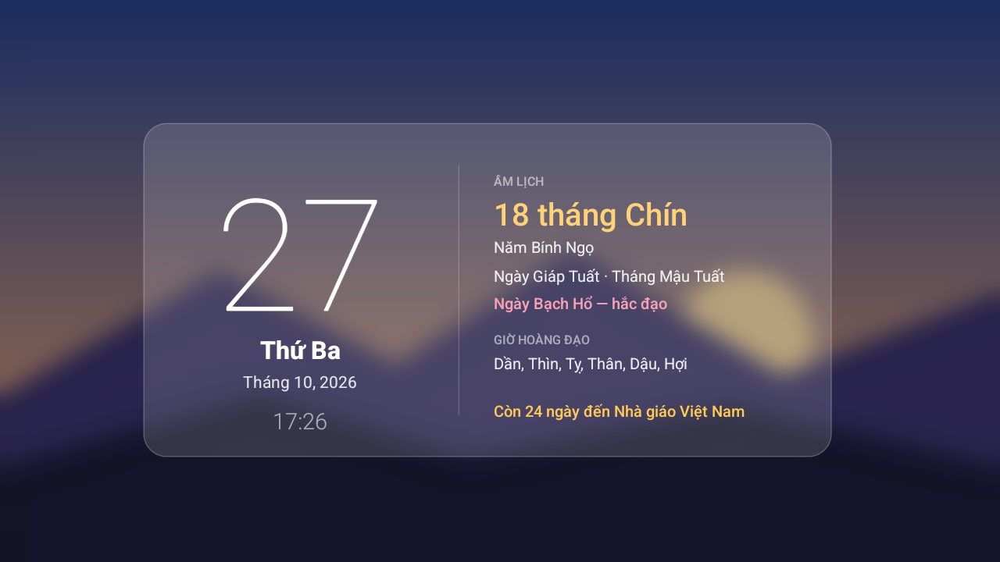 | 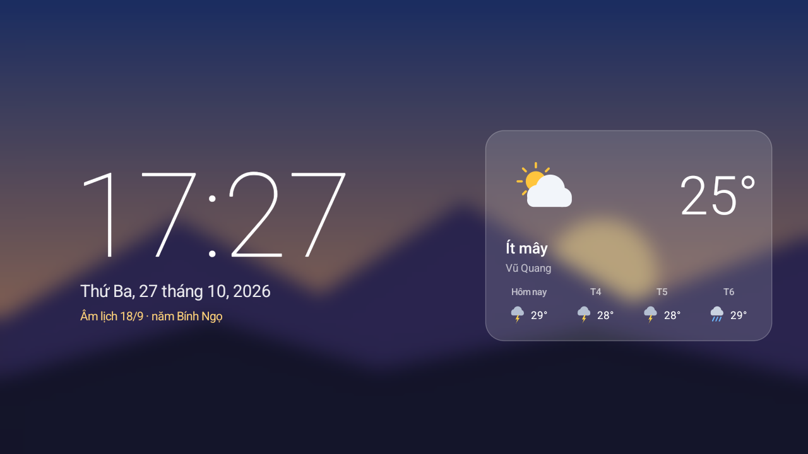 |
| 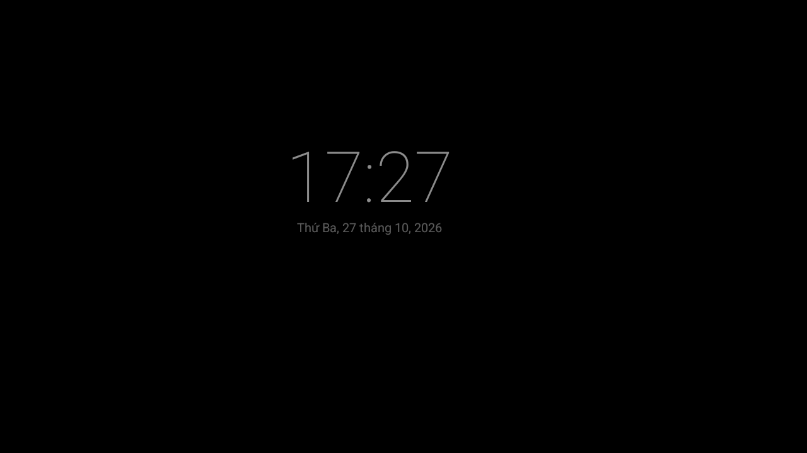 | 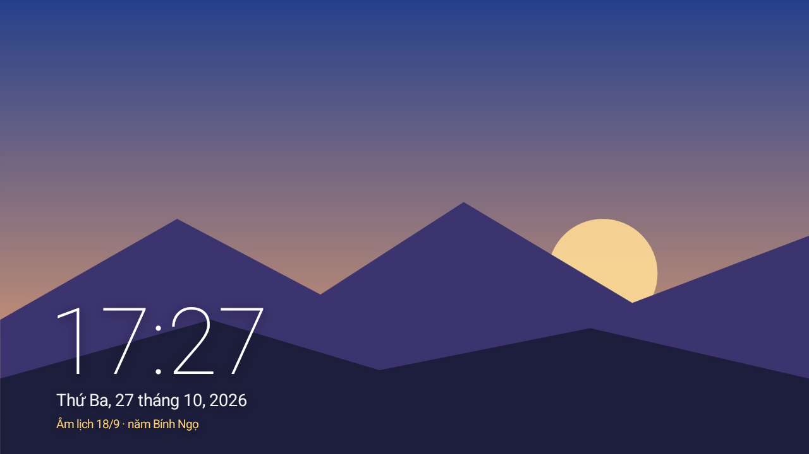 | 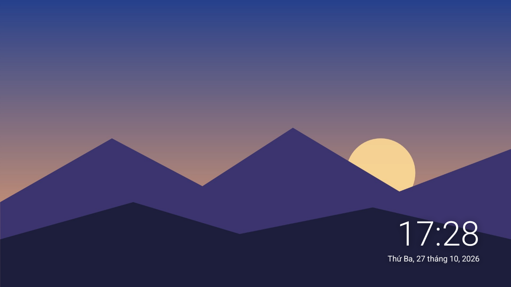 |

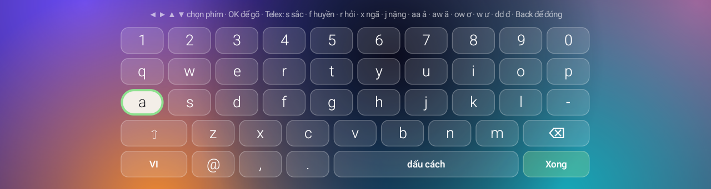

*(Ảnh chụp từ TV với ảnh nền demo; ảnh 05–07 render từ bản mẫu HTML trong `design/reference/`.)*

---

## Tính năng

### Màn hình chính
- **Đồng hồ** `HH:mm` cỡ lớn, nét mảnh; bên phải là **thứ**, **ngày dương** và **dòng âm lịch** ("Âm lịch 16/9 · năm Bính Ngọ").
- **Lời chào** ở góc trên (mặc định "Xin chào Thỏ Miu!", đổi được).
- **Lịch tháng có âm lịch**: tuần bắt đầu Thứ Hai, ngày âm nhỏ cạnh mỗi ngày dương, mùng 1 âm hiện dạng `1/9`, Chủ nhật
  màu hồng, hôm nay tô xanh. Âm lịch tính ngay trên TV theo giờ Việt Nam (thuật toán Hồ Ngọc Đức), không cần mạng,
  đúng cả tháng nhuận.
- **Thời tiết** (Open-Meteo, miễn phí, không cần API key): nhiệt độ, tình trạng trời, cảm giác như, độ ẩm, cao/thấp,
  khả năng mưa, dự báo 4 ngày. Nhập **tên thành phố hoặc quận/huyện** (có dấu hay không dấu đều được). Tự cập nhật
  30 phút một lần; mất mạng thì giữ số liệu cũ và ghi "mất kết nối", tự thử lại sau 2 phút.
- **Thẻ lịch và thẻ thời tiết rộng bằng nhau**; **3 màu nền**: Tím hồng (mặc định), Đại dương, Hoàng hôn.
- Nút **Wi-Fi** mở cài đặt Wi-Fi.

### Màn Lịch âm dương (chọn thẻ lịch trên Home, bấm OK)
- **Bên trái — thông tin ngày đang chọn:** thứ, ngày dương; ngày âm ("17 tháng Chín", tháng nhuận nếu có); năm Can Chi;
  **ngày và tháng Can Chi**; **tiết khí**; ngày **hoàng đạo / hắc đạo** (tên sao: Thanh Long, Kim Quỹ, Bạch Hổ…);
  **xung tuổi**; **6 giờ hoàng đạo** kèm khung giờ; **ngày lễ** dương lịch và âm lịch (Tết, Giỗ Tổ, Vu Lan, Trung thu…).
- **Bên phải — lịch tháng lớn:** ngày âm dưới mỗi ngày dương, chấm xanh = ngày hoàng đạo, chấm vàng = ngày lễ, mùng 1
  và rằm tô vàng, khung xanh = hôm nay. ◀ ▶ ▲ ▼ chọn ngày (tự sang tháng), **CH+ / CH−** (hoặc ⏪ ⏩) đổi tháng,
  **OK** về hôm nay.

### Màn Thời tiết (chọn thẻ thời tiết, bấm OK)
- **Hiện tại:** biểu tượng và nhiệt độ lớn, tình trạng trời, cao/thấp, cảm giác như, độ ẩm, gió, khả năng mưa,
  **chỉ số UV**, giờ **mặt trời mọc / lặn**.
- **Theo giờ:** 16 giờ tới (mỗi 2 giờ) với nhiệt độ và khả năng mưa.
- **7 ngày tới:** thứ/ngày, biểu tượng, khả năng mưa, thanh nhiệt độ thấp–cao trên cùng một thang cho cả tuần.
- OK để làm mới; dữ liệu cũ hơn 30 phút tự tải lại.

### Dock và màn Ứng dụng
- Dock **1–6 ô**, chứa app bất kỳ hoặc lối tắt (Cài đặt Android, Ứng dụng, Cài đặt giao diện). Mặc định: YouTube, Cửa
  hàng, Cài đặt, Ứng dụng.
- **Giữ OK** trên một ô dock: *Di chuyển* (◀ ▶ đổi chỗ, OK để xong), *Bỏ khỏi dock*, *Chọn ứng dụng trên dock…*
- Màn **Ứng dụng**: lưới 6 cột, mỗi app là icon bo góc trên thẻ kính. **Giữ OK** trên app: *Di chuyển* (◀ ▶ ▲ ▼),
  *Thêm vào / Bỏ khỏi dock*, *Thông tin ứng dụng*. Thứ tự được nhớ; app mới cài xếp cuối theo tên.

### Cài đặt giao diện
Là một ô trong màn Ứng dụng (thêm được vào dock), các thẻ xếp 2 cột: lời chào, vị trí thời tiết, ảnh nền, màu nền,
màn hình chờ, khoá trẻ em, ứng dụng trên dock, đặt lại thứ tự, dọn dẹp, mở Cài đặt Android. Cuối trang ghi phiên bản.

**Dọn dẹp** (mới ở 1.8.1): hiện RAM và bộ nhớ trống thật của TV; *Giải phóng RAM* đóng ứng dụng chạy nền và báo số MB
thực sự được giải phóng; *Xoá bộ nhớ đệm Tivi Home*; *Xoá bộ nhớ đệm ứng dụng khác* mở trang Bộ nhớ của TV. Android
không cho app thường xoá bộ nhớ đệm của app khác, và từ Android 14 cũng không cho đóng app khác, nên trên Android 14
nút Giải phóng RAM thường báo "RAM đã gọn".

### Ảnh nền màn hình chính (mới ở 1.8)
- Ảnh nằm sau lớp kính mờ. **Tự quét mọi ảnh** trong bộ nhớ trong và USB, hiện thành lưới (mới nhất trước) kèm tên
  file và nơi lưu — không cần duyệt thư mục.
- **Độ mờ**: Rõ nét / Mờ nhẹ / Mờ nhiều. **Cách hiển thị**: Lấp đầy (cắt cho kín màn) hoặc Vừa khung (hiện trọn ảnh,
  phần thừa là nền mờ của chính ảnh). Bỏ ảnh nền thì quay về màu nền gradient.

### Màn hình chờ (mới ở 1.8)
- 6 mẫu: **Đồng hồ kính**, **Lịch âm dương** (kèm ngày lễ sắp tới), **Thời tiết**, **Đêm tối giản**, **Ảnh nền** và
  **Tuỳ chỉnh** — trình chiếu tối đa 30 ảnh tự chọn, mỗi ảnh 10 giây – 5 phút, bật/tắt đồng hồ.
- Nội dung trôi nhẹ mỗi phút để không lưu ảnh trên màn hình. Có nút **Xem thử**.
- **Thời gian chờ** 5 phút – 1 giờ hoặc tắt; **Dùng làm màn hình chờ của TV** đặt Tivi Home làm screensaver hệ thống
  (cần quyền mà `install.ps1` cấp qua ADB; thiếu quyền thì mở cài đặt màn hình chờ của TV).
- Muốn trả lại màn hình chờ cũ: `adb shell settings put secure screensaver_components <gói>/<dream cũ>`.

### Khoá trẻ em
- Nút **ổ khoá** góc trên bên phải, **mặc định tắt**. Chọn cho bé xem **15 phút, 30 phút, 1 tiếng, 2 tiếng** hoặc
  **tuỳ chỉnh 1–240 phút** (▲▼ ±5 phút, ◀▶ ±1 phút, hoặc bấm số; số tuỳ chỉnh được nhớ).
- Đang hẹn giờ: nút chuyển vàng kèm "Còn X phút"; màn khoá trẻ em hiện **đồng hồ đếm ngược**; còn 1 phút thì báo trước.
- **Hết giờ**: màn khoá phủ lên **mọi app** (kể cả YouTube), tạm dừng phim và tắt tiếng; nút Back bị chặn.
- **Mở khoá, đổi hoặc tắt hẹn giờ cần mã PIN 8 số** nhập bằng **bàn phím số trên màn hình** (hoặc phím số trên remote).
  Mã PIN là **ngày giờ hiện tại dạng `ddMMHHmm`** — ví dụ 25/10 lúc 18:54 → `25101854` (chấp nhận cả phút trước đó).
  *Repo công khai thì ai đọc README cũng biết công thức; để repo Private nếu không muốn.*
- **Rút điện hay khởi động lại không thoát được khoá**: hết giờ trong lúc tắt máy thì bật lên là khoá ngay; thời gian
  hẹn vẫn tính trong lúc tắt máy.
- "Khoá ngay" không cần mã.

### Bàn phím Tivi (gõ tiếng Việt kiểu Telex)
- **Bàn phím hệ thống** cùng style theme (phím kính, focus kem viền xanh, nền gradient theo màu nền đang chọn) —
  dùng được ở **mọi app** trên TV: ô tìm kiếm YouTube, mật khẩu Wi-Fi, lời chào, vị trí thời tiết…
- Bố cục **QWERTY** + hàng số; chọn phím bằng ◀ ▶ ▲ ▼, OK để gõ; phím số trên remote gõ thẳng.
- **Telex**: `s` sắc · `f` huyền · `r` hỏi · `x` ngã · `j` nặng · `z` bỏ dấu · `aa` â · `ee` ê · `oo` ô · `aw` ă ·
  `ow` ơ · `uw`/`w` ư · `dd` đ; gõ lại phím dấu để bỏ dấu ("ass" → "as"). Dấu tự đặt đúng nguyên âm khi gõ tiếp
  ("hoaf" + "n" → "hoàn").
- Phím **VI / ABC** tắt Telex; ô mật khẩu, email, link tự chuyển sang ABC. Tự viết hoa chữ đầu ở ô tên/câu.
- Phím **?123** chuyển sang bảng ký tự đặc biệt (`@ # $ % & * - + = / ( ) [ ] { } ! ? : ; ' " _ ~ ^ < > |`),
  bấm **ABC** để quay lại bảng chữ.
- **Gõ bằng giọng nói** (mới ở 1.8.2): phím **Nói** (hoặc nút micro/tìm kiếm trên remote khi bàn phím đang mở) nghe
  qua micro trên remote, hiện chữ dần trên dòng gợi ý rồi chèn vào ô đang nhập; chế độ VI nhận tiếng Việt, ABC nhận
  tiếng Anh. Dùng dịch vụ giọng nói có sẵn của TV (Google) nên cần mạng; lần đầu hỏi quyền micro (`install.ps1` cấp sẵn).
- Phím đang chọn chỉ đổi nền sang màu kem, giữ nguyên bo góc và viền như các phím khác.
- Bàn phím chỉ chiếm nửa dưới màn hình, ô đang nhập vẫn nhìn thấy.

### Nhẹ và an toàn
- APK ~120 KB, chỉ dùng Android framework (không AndroidX, không thư viện ngoài); icon và nền vẽ bằng code; ảnh nền
  được thu nhỏ và làm mờ một lần rồi lưu đệm. Hợp với TV box RAM 1 GB.
- Quyền: `INTERNET` (chỉ để lấy thời tiết), `SYSTEM_ALERT_WINDOW` + foreground service (khoá trẻ em), đọc ảnh (ảnh nền,
  trình chiếu), `WRITE_SETTINGS` / `WRITE_SECURE_SETTINGS` (màn hình chờ, cấp qua ADB), `RECORD_AUDIO` (chỉ khi bấm
  Nói trên bàn phím), `KILL_BACKGROUND_PROCESSES` (Dọn dẹp). Không quảng cáo, không thu thập dữ liệu. Xem
  [CHANGELOG.md](CHANGELOG.md) cho lịch sử phiên bản.
- Bố cục thiết kế trên sân khấu 960×540dp và phóng đều theo màn hình (720p, 1080p, 4K đều giống nhau).

---

## Cài lên TV

**Yêu cầu:** Android TV / TV box **Android 8.0 trở lên**, máy tính Windows cùng mạng, JDK 17 và Android SDK
(platform `android-34`, build-tools `34.0.0`, platform-tools). Không cần Android Studio hay Gradle.

```
buildtools/
  jdk/<thư mục JDK 17>/
  android-sdk/platforms/android-34/   build-tools/34.0.0/   platform-tools/
tivihome/          <- repo này
```

1. Trên TV: **Cài đặt → Thiết bị → Giới thiệu → bấm "Bản dựng" 7 lần**, rồi bật **Gỡ lỗi USB** (và **Gỡ lỗi ADB qua
   mạng** nếu có) trong Tuỳ chọn nhà phát triển.
2. **Build** (chạy test âm lịch trước khi build):
   ```powershell
   powershell -ExecutionPolicy Bypass -File build.ps1 -VersionCode 21 -VersionName 1.8.3
   ```
   Bộ công cụ ở chỗ khác thì thêm `-BuildTools D:\duong\dan\buildtools`. Lần đầu tạo khoá ký `debug.keystore` —
   **giữ file này** (đã nằm trong `.gitignore`): mất khoá thì bản sau không cài đè được.
3. **Cài** (đồng thời cấp quyền khoá trẻ em và mở app); bấm "Cho phép" khi TV hỏi "Allow USB debugging?":
   ```powershell
   powershell -ExecutionPolicy Bypass -File install.ps1 -Tv 192.168.1.50
   ```
4. **Đặt làm màn hình chính** — xem app chạy ổn rồi mới làm:
   ```powershell
   adb -s 192.168.1.50:5555 shell cmd package set-home-activity com.tivibox.home/.MainActivity
   ```
   Bấm Home trên remote, kiểm tra `adb shell "dumpsys activity activities | grep mFocusedApp"` ra `com.tivibox.home`,
   rồi mới **tắt** launcher cũ: `adb shell pm disable-user --user 0 <gói launcher cũ>` (tắt, không gỡ).
5. **Bật Bàn phím Tivi** (tuỳ chọn): trên TV vào Cài đặt → Bàn phím → chọn "Bàn phím Tivi", hoặc
   ```powershell
   adb -s 192.168.1.50:5555 shell ime enable com.tivibox.home/.KeyboardService
   adb -s 192.168.1.50:5555 shell ime set com.tivibox.home/.KeyboardService
   ```
   Đổi lại bàn phím cũ: `adb shell ime set <bàn phím cũ>` (xem tên bằng `adb shell ime list -s`).
6. Xong việc: tắt Gỡ lỗi USB / ADB qua mạng trên TV (cổng 5555 không mã hoá).

**Khôi phục:** `restore-old-launcher.ps1 -Tv <ip>` bật lại launcher CleanYourTV (`com.gathin.tvhome`) và đặt nó làm
Home; với launcher khác dùng `pm enable <gói>` + `set-home-activity`. Gỡ app: bật lại launcher cũ trước, rồi
`adb uninstall com.tivibox.home`. `undo-debloat-group1.ps1` bật lại nhóm gói hệ thống đã tắt khi dọn rác.

---

## Dùng với AI (Claude, ChatGPT, Gemini…)

Dán link repo này vào AI kèm yêu cầu. AI có thể đọc [`AGENTS.md`](AGENTS.md) để biết đọc gì và theo quy tắc nào;
design system nằm trong [`design/`](design/). Copy nguyên câu lệnh dưới đây (đã có sẵn link repo), chỉ thay phần trong `<...>`:

**Thiết kế màn hình mới cùng phong cách**
```
Đọc design system tại https://github.com/tuanpa-1702/restore-your-tivi (bắt đầu từ AGENTS.md, rồi design/DESIGN.md và design/tokens/tokens.json,
xem mẫu trong design/reference/ và ảnh trong design/screenshots/).
Thiết kế màn hình "<tên màn hình>" cho TV theo đúng design system đó: sân khấu 960x540, nền mesh "Tím hồng",
thẻ kính, focus nền kem viền xanh, chữ Roboto, điều khiển bằng remote. Xuất ra một file HTML độc lập.
```

**Thêm widget vào màn hình chính**
```
Theo design system ở https://github.com/tuanpa-1702/restore-your-tivi, thiết kế thêm thẻ "<tên widget>" thay cho thẻ thời tiết trên màn hình chính
(cùng kích thước, kiểu thẻ kính, tiêu đề 15dp, có huy hiệu icon). Dựa trên design/reference/home.html.
```

**Dựng lại bằng nền tảng khác**
```
Dùng design system ở https://github.com/tuanpa-1702/restore-your-tivi để dựng lại màn hình chính bằng <Jetpack Compose / Flutter / SwiftUI / Figma>.
Giữ nguyên token màu, cỡ chữ, bo góc, kiểu focus và sân khấu 960x540 phóng đều theo màn hình.
```

**Nhờ AI cài lên TV** (AI có quyền chạy lệnh như Claude Code, Codex, Cursor)
```
Clone https://github.com/tuanpa-1702/restore-your-tivi, đọc AGENTS.md và README.md. TV box của tôi ở IP <192.168.1.50>, đã bật USB debugging.
Build bằng build.ps1, cài bằng install.ps1, chụp màn hình kiểm tra. Hỏi tôi trước khi đặt làm Home mặc định
hoặc tắt launcher cũ; chỉ tắt (pm disable-user), không gỡ ứng dụng hệ thống.
```

Thêm prompt và mẹo: [`design/PROMPT.md`](design/PROMPT.md). AI không mở được link repo thì dán link file thô
`https://raw.githubusercontent.com/tuanpa-1702/restore-your-tivi/main/design/DESIGN.md`.

---

## Cấu trúc repo

| Đường dẫn | Nội dung |
|---|---|
| `app/` | Mã nguồn Android: `AndroidManifest.xml`, `java/com/tivibox/home/`, `res/` (layout, drawable vector) |
| `test/` | Test âm lịch (Tết, tháng nhuận…), đặt dấu tiếng Việt và Telex — chạy tự động khi build |
| `build.ps1` / `install.ps1` | Build APK không cần Gradle / cài qua ADB mạng và cấp quyền |
| `restore-old-launcher.ps1`, `undo-debloat-group1.ps1` | Khôi phục launcher cũ / bật lại gói đã tắt |
| `design/DESIGN.md` | Đặc tả thiết kế: nguyên tắc, lưới, màu, chữ, focus, component, điều hướng remote |
| `design/tokens/` | Giá trị chính xác (`tokens.json`, `tokens.css`) |
| `design/reference/` | Bản mẫu HTML từng màn hình (mở `home.html` bằng trình duyệt) |
| `design/screenshots/` | Ảnh render từ bản mẫu; `design/tools/render.ps1` render lại |
| `AGENTS.md`, `CLAUDE.md`, `llms.txt` | Hướng dẫn cho AI |

## Giới hạn đã biết

- Khoá trẻ em không chặn được: chuyển nguồn HDMI, cast từ điện thoại, hoặc vào Cài đặt Android buộc dừng / xoá dữ liệu
  Tivi Home (nên đặt mật khẩu cho Cài đặt nếu TV hỗ trợ).
- Mã PIN theo giờ của TV: nếu box mất giờ (không có mạng sau khi mất điện), mã đúng là theo giờ đang sai đó.
- Một số firmware có thể không cho đặt launcher bên thứ ba làm Home, hoặc không có trang cấp quyền "hiển thị trên ứng
  dụng khác" (khi đó `install.ps1` cấp qua ADB).

## Ghi nhận

Âm lịch theo thuật toán của Hồ Ngọc Đức · Thời tiết: [Open-Meteo](https://open-meteo.com) · Ý tưởng dọn TV và thay
launcher từ [CleanYourTV](https://github.com/Gathin23/cleanyourtv).
